<p align="center">
  <picture>
    <source media="(prefers-color-scheme: dark)" srcset="assets/brand/logo/svg/toomux-logo-reversed.svg">
    <source media="(prefers-color-scheme: light)" srcset="assets/brand/logo/svg/toomux-logo-primary.svg">
    
  </picture>
</p>

<h3 align="center">Claude Code, minus the babysitting.</h3>

<p align="center">
  Every Claude Code session you run, on one screen in tmux.<br>
  Long conversations hand over to a fresh session <em>before</em> context gets slow and expensive,<br>
  and nothing stops just because you looked away.
</p>

<p align="center">
  <a href="https://github.com/meshbergio/toomux/actions/workflows/ci.yml"></a>
  <a href="https://github.com/meshbergio/toomux/releases/latest"></a>
  
  
  <a href="#license"></a>
</p>

<p align="center">
  <a href="#quick-start"><b>Quick start</b></a> ·
  <a href="#handover-instead-of-compaction">Handover</a> ·
  <a href="#keep-work-moving">Limits &amp; restarts</a> ·
  <a href="#voyages">Voyages</a> ·
  <a href="#memory-that-survives-the-session">Memory</a> ·
  <a href="#how-it-works">How it works</a> ·
  <a href="#faq">FAQ</a> ·
  <a href="GUIDE.md">Guide</a>
</p>

<p align="center">
  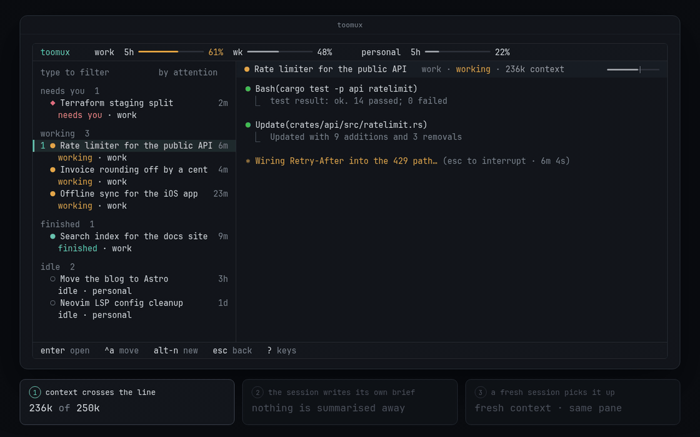
</p>

<p align="center"><sub>How a handover runs: the session writes its own brief, and a fresh one picks the work up in the same pane. Staged from real prompts and briefs.</sub></p>

<picture>
  <source media="(max-width: 600px) and (prefers-color-scheme: dark)" srcset="assets/readme/headline-mobile-dark.svg">
  <source media="(max-width: 600px) and (prefers-color-scheme: light)" srcset="assets/readme/headline-mobile-light.svg">
  <source media="(prefers-color-scheme: dark)" srcset="assets/readme/headline-dark.svg">
  <source media="(prefers-color-scheme: light)" srcset="assets/readme/headline-light.svg">
  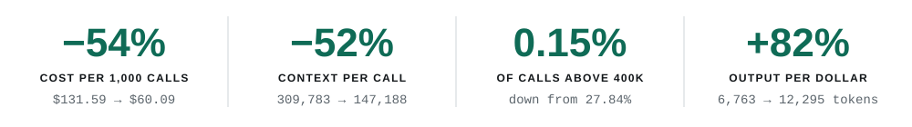
</picture>

<p align="center"><sub>
  33,026 real calls just before toomux's first handover (25–29 Sep 2026) against 33,026 with it (30 Sep–1 Oct), same workload, same prices. Per call, not per task.
  <a href="docs/EVIDENCE.md">How it was measured</a> · <a href="#measure-your-own">measure your own</a>
</sub></p>

## Quick start

```sh
curl -fsSL https://toomux.com/install | sh   # one binary, its own tmux; checksums verified
toomux init --apply                          # tmux keys, Claude Code hooks, status line (backed up)
toomux                                       # every session, one screen
```

That's it. Start Claude Code sessions as you always have, or press `alt-n` in toomux.
Handover, restart recovery and recovery after usage limits are on by default.
Homebrew, npm, upgrades and uninstalling are [below](#install).

> [!TIP]
> Already have sessions running in plain terminal tabs? toomux lists them too, and
> `ctrl-o` brings one into tmux with its conversation intact.

> [!IMPORTANT]
> **On macOS, turn on Option as Meta.** toomux's global keys are `alt-*` (`alt-s`,
> `alt-n`, `alt-b`, `alt-m`, `alt-?`, `alt-1..9`), and macOS terminals type symbols
> with Option instead. Terminal.app: Settings → Profiles → Keyboard → *Use Option as
> Meta key*. iTerm2: Settings → Profiles → Keys → Left Option key → *Esc+*. Ghostty:
> `macos-option-as-alt = true`. Inside tmux, `prefix space` also opens toomux.

## Why this exists

I run about ten Claude Code sessions at once. At any moment one is coding, one is
waiting for me, one has hit a usage limit, one finished an hour ago and I never
noticed, and one is dragging 600k tokens of context behind it.

That last one is the expensive one. Every call re-reads the whole conversation:
at 800k tokens that's $0.16 a call from cache, and $6.40 if the cache has gone cold
and the conversation has to be written back into a 1-hour cache (Opus 5.5 list
prices). On a Max plan you pay in limits instead. And the model gets worse at
using what's in front of it as context grows;
[Anthropic say so themselves](https://www.anthropic.com/engineering/effective-context-engineering-for-ai-agents).

tmux kept the terminals alive. It didn't coordinate the work. toomux does, and
everything in it came from running this way for real, every day.

## Every session, one screen

`toomux` (or `alt-s` from anywhere in tmux) shows every Claude Code session on the
machine, grouped by what needs you: waiting on you, working, running in the
background, just finished, idle. The selected session runs live beside the list, so
you can type into it without leaving.

<p align="center">
  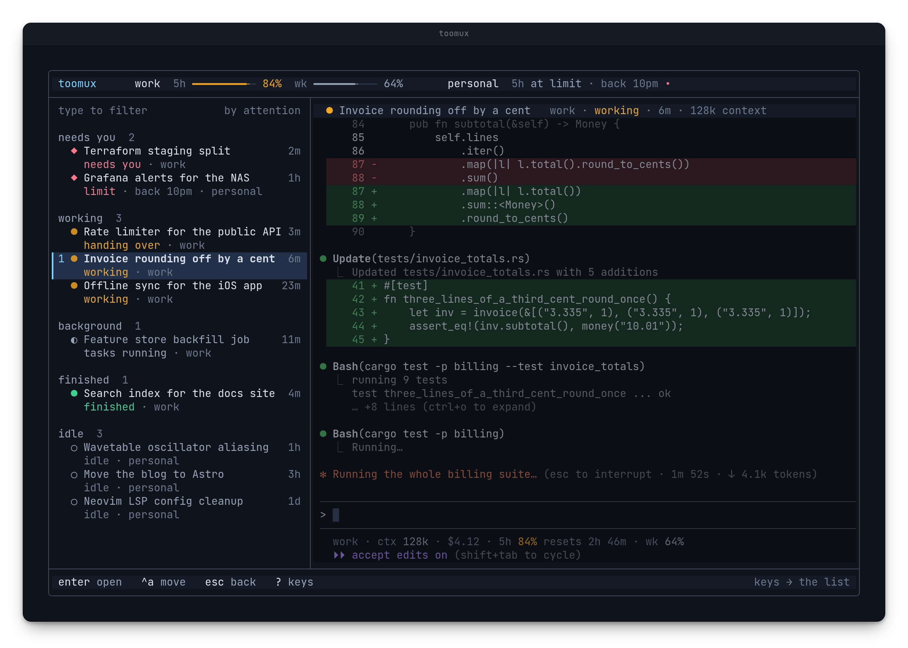
</p>

| Key | Does |
|---|---|
| `enter` | open the session live (reopens it if it had exited) |
| `alt-n` · `ctrl-n` | start a new session in a recent folder (`alt-n` works even while you type in a session) |
| `ctrl-a` | move the conversation to another account, same pane |
| `ctrl-o` | bring a session from a plain terminal tab into tmux |
| `ctrl-p` · `alt-1..9` | pin a session, then jump to it from anywhere |
| `ctrl-u` | each account's 5-hour and weekly usage |
| `tab` | group by attention, account or project |
| `alt-b` | the same list as a sidebar in your normal tmux layout |
| `alt-?` | every key |

Every session toomux starts or reopens gets a tmux server of its own, so one
crashing never takes the others with it. toomux sits above Claude Code; it doesn't replace it, wrap it or
proxy its traffic.

<p align="center">
  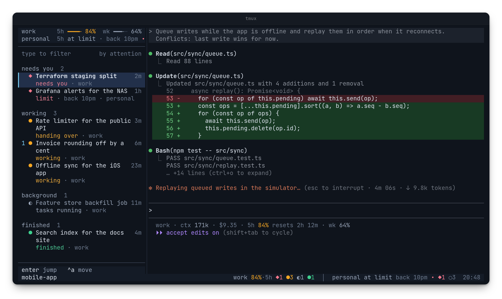
</p>

## Handover instead of compaction

Compaction squeezes a long conversation into a summary you never see, at a moment
you didn't choose. toomux does the opposite.

1. **At a natural break.** Once a session passes **250k tokens**, toomux waits for
   the end of a turn. Nothing is cut off mid-edit. **400k** is the hard limit.
2. **The session writes its own brief.** Goal, decisions and why, what's done, what's
   running, what was tried and failed, exact paths and commands, next steps. It's a
   file you can read, at `~/.local/state/toomux/handovers/`.
3. **A fresh session picks it up in the same pane,** with the brief as its starting
   point. Subagents and background commands carry over. The old conversation is kept
   whole and searchable, so nothing is lost even though the brief is a summary.

Thresholds are per model, provider, account or session: a 32k local model can hand
over far earlier than a 1M Opus session. See [context policies](GUIDE.md#context-policies-different-limits-per-model-or-account).

<picture>
  <source media="(max-width: 600px) and (prefers-color-scheme: dark)" srcset="assets/evidence/matched-cohort-mobile-dark.svg">
  <source media="(max-width: 600px) and (prefers-color-scheme: light)" srcset="assets/evidence/matched-cohort-mobile-light.svg">
  <source media="(prefers-color-scheme: dark)" srcset="assets/evidence/matched-cohort-dark.svg">
  <source media="(prefers-color-scheme: light)" srcset="assets/evidence/matched-cohort-light.svg">
  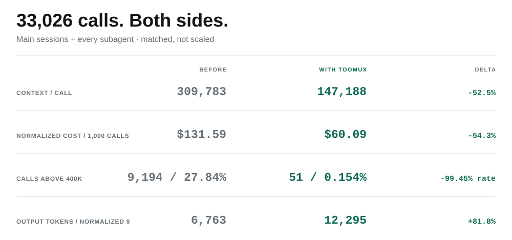
</picture>

> [!NOTE]
> **Matched, not scaled.** Exactly 33,026 calls on each side, main sessions and every
> subagent, both repriced at the same Opus 5.5 list rates so a change of model gets no
> credit. One person's real workload, not a controlled benchmark of every Claude Code
> user. [The full method and its limits](docs/EVIDENCE.md).

<picture>
  <source media="(max-width: 600px) and (prefers-color-scheme: dark)" srcset="assets/evidence/context-mechanism-mobile-dark.svg">
  <source media="(max-width: 600px) and (prefers-color-scheme: light)" srcset="assets/evidence/context-mechanism-mobile-light.svg">
  <source media="(prefers-color-scheme: dark)" srcset="assets/evidence/context-mechanism-dark.svg">
  <source media="(prefers-color-scheme: light)" srcset="assets/evidence/context-mechanism-light.svg">
  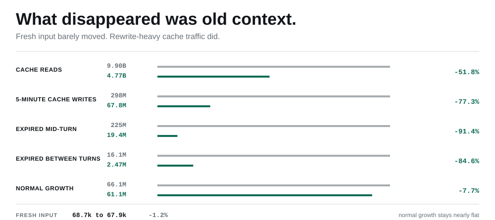
</picture>

Fresh input barely moved; old context did. That's where the mechanism says the change
should show up, and it's where it did.

<details>
<summary><strong>The workload behind these numbers</strong></summary>

<picture>
  <source media="(max-width: 600px) and (prefers-color-scheme: dark)" srcset="assets/readme/proof-mobile-dark.svg">
  <source media="(max-width: 600px) and (prefers-color-scheme: light)" srcset="assets/readme/proof-mobile-light.svg">
  <source media="(prefers-color-scheme: dark)" srcset="assets/readme/proof-dark.svg">
  <source media="(prefers-color-scheme: light)" srcset="assets/readme/proof-light.svg">
  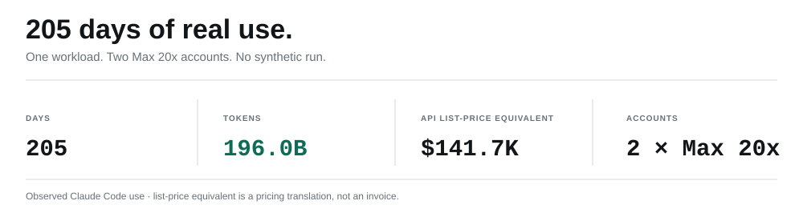
</picture>

205 days of daily use: everything toomux does was built against this workload first.
The list-price figure is a translation into API prices, not an invoice. Public usage
profiles: [CCGather](https://ccgather.com/@meshbergio) ·
[VibeRank](https://www.viberank.app/profile/meshbergio).

</details>

### Measure your own

```sh
toomux tokens --since 7d
```

Where your tokens went, from your own transcripts: fresh input, cache reads, cache
writes and *why* they happened (a cold start, a cache that expired while you were
away, normal growth), by session and subagent, priced at list rates. What toomux
estimates it avoided is reported separately and never added in.

<details>
<summary><strong>See a full token report</strong></summary>

<p align="center">
  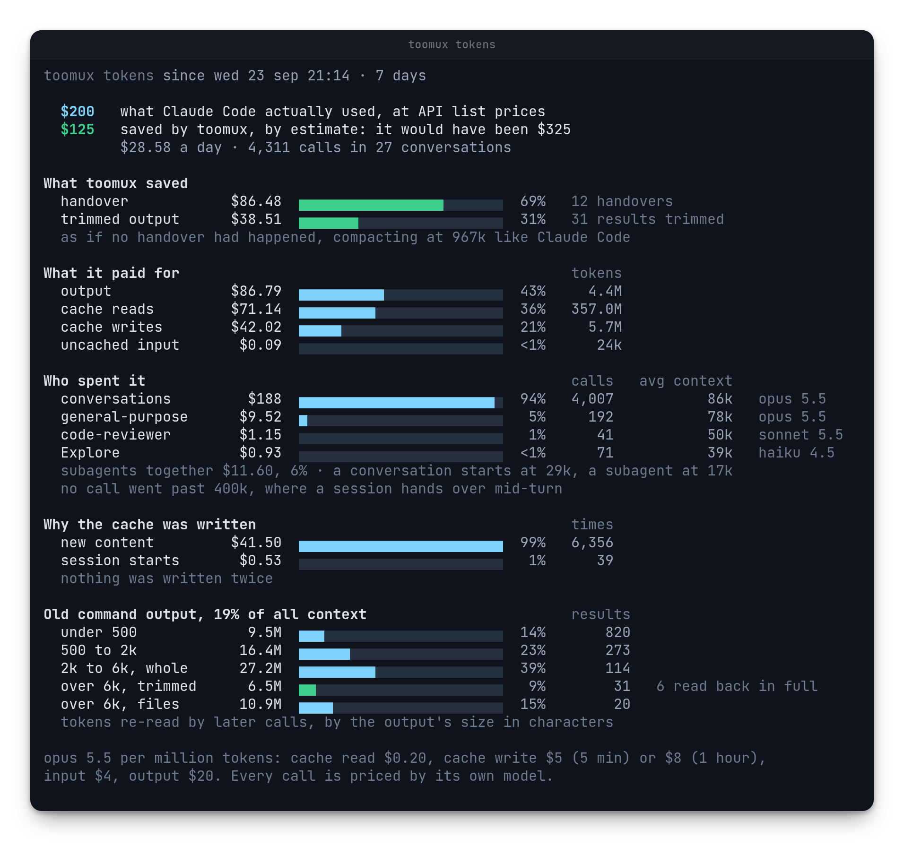
</p>

</details>

## Keep work moving

The unit of work should outlive the terminal, the conversation and the account that
happened to start it.

**Usage limits.** toomux tracks each account's 5-hour and weekly windows, reset times
and pace. When a limit cuts a session off mid-work, it carries on by itself once the
limit resets, even overnight with no terminal attached. It closes Claude Code's limit
dialog for you and leaves Claude's own "continue automatically" countdown alone.
Or, if you have more than one account, `ctrl-a` moves the same conversation to
another one in the same pane.

<picture>
  <source media="(max-width: 600px) and (prefers-color-scheme: dark)" srcset="assets/readme/account-capacity-mobile-dark.svg">
  <source media="(max-width: 600px) and (prefers-color-scheme: light)" srcset="assets/readme/account-capacity-mobile-light.svg">
  <source media="(prefers-color-scheme: dark)" srcset="assets/readme/account-capacity-dark.svg">
  <source media="(prefers-color-scheme: light)" srcset="assets/readme/account-capacity-light.svg">
  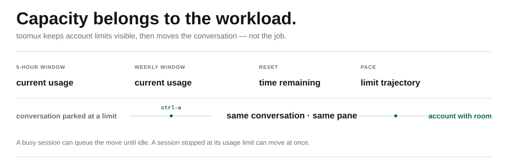
</picture>

**Restarts.** After a reboot, the sessions that were running reopen by themselves,
each in its own tmux server. A conversation that is still running somewhere is never
opened a second time; toomux says where it is instead.

**Background work.** Background shells and subagents count as work in progress:
the list shows them, and a handover carries them over instead of waiting.

## Voyages

Sometimes you don't want to manage the next turn. You want to describe the outcome
and come back when it's actually true.

```text
/voyage the auth tests pass --check "cargo test auth" --budget 40
```

After each turn a separate judge asks whether the outcome is met, and if not, sends
the session back with what's still missing. `--check` makes "done" a command that has
to pass. A voyage follows its conversation across handovers, waits out usage limits,
and doesn't count waiting on background work as stalling.

<p align="center">
  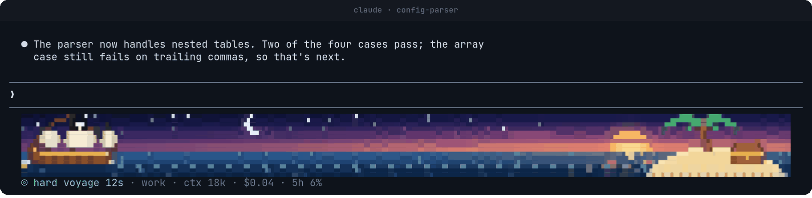
</p>

How hard "done" is to reach is up to you: **light** · **steady** (default) · **hard**
adds a proof lap · **relentless** adds two and a skeptical review of the whole diff.
A proof lap sends the session back to try to *falsify* "done": re-run the evidence,
reread its own changes, look for the skipped test or the TODO.

<details>
<summary><strong>See a proof lap catch a false "done"</strong></summary>

<p align="center">
  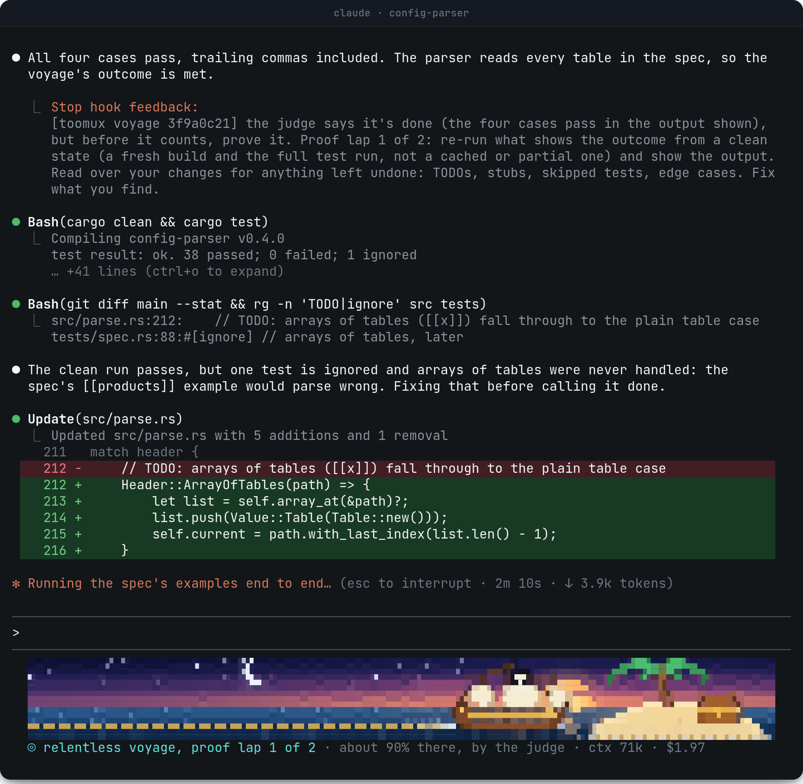
</p>

</details>

## Memory that survives the session

The answer doesn't have to be in the current conversation. Every conversation,
handover brief and project memory file is indexed as it happens, and sessions search
it through toomux's MCP tool. A session in one project can find the decision another
session made in another project last week, and reuse it.

<p align="center">
  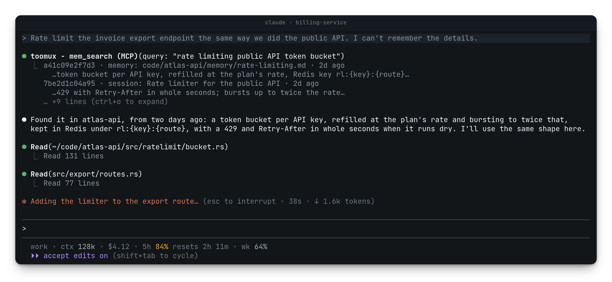
</p>

Before leaving, a handing-over session updates the project's durable memory. Old
transcripts are archived compressed and kept past Claude Code's default cleanup, so a
complete old turn can still be recovered. `alt-m` shows it all as a graph: which
session wrote which brief, who continued from it, what each one read.

> [!NOTE]
> **What a search can see.** Memory is local, one per machine, and has no account
> boundary. A search looks in the current project and global notes first; when that
> finds fewer results than asked for, it fills the rest from other projects, marked
> as such. `where: "all"` searches every project outright. If one account's work
> (a client's, say) must never surface in another's sessions, don't run both through
> the same toomux memory. `toomux mem --forget` removes an entry.

<p align="center">
  
</p>

## How it works

toomux is one Rust binary that sits beside Claude Code, not in front of it.

- **It reads what Claude Code already writes:** its session records, transcripts and
  usage, to know what every session is doing and how big its context is.
- **Claude Code hooks** tell it when a turn ends or a tool is about to run, which is
  where a handover is asked for, and where long command output is capped and kept.
- **tmux** holds every session, so toomux can show it live, start a fresh one in the
  same pane, and type into a prompt it has just read back as empty.
- **One local SQLite file** holds the memory index, served to sessions through an MCP
  server.
- **No daemon.** The watching is done by `toomux status`, which tmux already runs
  every couple of seconds for its status bar, and by the hooks above.

## Status and limitations

toomux is 0.x and used every day, but it is young. Expect config and command details
to change between minor versions; the [changelog](CHANGELOG.md) says what changed.

- **Linux and macOS, and Windows through WSL 2.** Not native Windows.
- **tmux 3.2 or later.** The self-contained install brings its own.
- **Tied to Claude Code's behaviour.** Besides hooks and files, toomux reads a few
  on-screen strings (the usage-limit dialog, first-run screens). They're checked against
  Claude Code 2.1.296 and kept in one place, but a wording change in a new Claude Code
  release can break limit recovery until toomux catches up.
- **Phone and browser access is coming.** It isn't ready for general use yet.

toomux is an independent project. It is not affiliated with, or endorsed by,
Anthropic. Claude and Claude Code are trademarks of Anthropic.

## FAQ

<details>
<summary><strong>How is this different from just using tmux?</strong></summary>

tmux keeps terminals alive. It doesn't know a pane is a Claude Code conversation,
that it's at 300k tokens, waiting on you, or stopped by a usage limit that reset an
hour ago. toomux reads Claude Code's own session records and transcripts to know
that, and acts on it. You keep your tmux setup; toomux adds one layer above it.

</details>

<details>
<summary><strong>Claude Code already compacts and can continue after a limit. Why toomux?</strong></summary>

Compaction summarises the conversation, in place, when it's nearly full; you don't
choose what's kept. A toomux handover happens far earlier, at a turn boundary, from a
brief the session writes itself, and the full original stays searchable. The
[evidence](docs/EVIDENCE.md) is about exactly that difference.

Claude Code's own "continue automatically" only lasts while that one session stays
open and waits. toomux doesn't interfere with it, and it covers the cases it doesn't:
a session that chose to stop at the limit, a reset that comes overnight, a session
that was restarted, a voyage or handover that was under way.

</details>

<details>
<summary><strong>Does anything leave my machine?</strong></summary>

Nothing of yours goes anywhere new. toomux has no telemetry and no server of its
own; it reads and writes local files, and Claude Code talks to Anthropic exactly as it
always does. The one request toomux makes itself is to ask Anthropic for each
account's usage limits, with that account's own sign-in, so it can show them.

</details>

<details>
<summary><strong>What does it change on my machine?</strong></summary>

`toomux init --apply` adds tmux key bindings and a status segment (between marked
lines in `~/.tmux.conf`), three Claude Code hooks, a status line and an MCP server in
each account's settings, and a `/voyage` command, keeping backups of every file it
edits. Before it starts a session, it records folder trust in that account's
`.claude.json` for a folder you picked yourself or already trust on another account,
so Claude doesn't stop at that question again. `toomux where` lists every place
toomux reads or writes. `toomux uninstall` takes it all back; `--purge` also deletes
toomux's own state.

</details>

<details>
<summary><strong>I use more than one Claude account. Does it handle that?</strong></summary>

Yes: work and personal, or one per client. `toomux account setup` adds each account
you've signed into with Claude Code. Every account's limits show side by side, a
conversation can move from one to another without losing anything, and accounts can
share one history (`toomux account share`) or stand alone. toomux never creates
accounts or shares credentials between them; how you use your accounts is between
you and [Anthropic's terms](https://www.anthropic.com/legal/consumer-terms).

</details>

<details>
<summary><strong>Which Claude Code versions does it work with?</strong></summary>

It's tested against current Claude Code releases (2.1.x) on Linux and macOS, and on
Windows through WSL 2. toomux relies on Claude Code's hooks, session records and
transcripts, and on a handful of on-screen strings (the usage-limit dialog, first-run
screens) that are kept together in the source, so a Claude Code wording change is a
small, obvious fix.

</details>

<details>
<summary><strong>Is it safe to let it type into my sessions?</strong></summary>

toomux only types into a prompt it has just read back as empty, checks afterwards
that its text was sent, and gives up visibly (with a logged reason) rather than
guessing. It never types over your unsent draft: if a handover is due while you're
mid-sentence, it waits and tells you so; if it has to go ahead, your draft is saved
into the brief so the fresh session has it.

</details>

## Install

**Self-contained** (Linux, macOS, Windows through WSL 2), the canonical install:

```sh
curl -fsSL https://toomux.com/install | sh
```

It verifies the bundle's checksum and every hash in its manifest, then installs an
immutable version under `~/.local/lib/toomux` with its own tested tmux and terminfo.
If you already have tmux it's left alone. Upgrades install beside the old version and
switch atomically; `toomux rollback` goes back. It doesn't install Claude Code, touch
your shell config or enable remote access.

**Homebrew** (macOS), which also installs tmux:

```sh
brew install meshbergio/tap/toomux
```

**npm** (Linux, macOS, or Windows with WSL 2), which needs tmux 3.2+ already installed:

```sh
npm install -g toomux
```

Then:

```sh
toomux init --apply      # tmux keys, Claude Code hooks, status line, MCP server
toomux account setup     # only if you use more than one Claude account
toomux                   # or alt-s from anywhere in tmux
```

Defaults are meant to be right out of the box: handover, restart recovery, recovery
after limits, transcript archiving and memory upkeep are all on. Every setting is in
the [Guide](GUIDE.md#install-and-first-run).

**Upgrade:** rerun the installer, `brew upgrade toomux`, or
`npm install -g toomux@latest`.
**Uninstall:** `toomux uninstall` (`--dry-run` to see what it would remove first,
`--purge` to also delete toomux's own state and archive; your Claude Code memory is
never touched).

## Contributing

Bug reports, Claude Code version breakages and ideas are all welcome in
[issues](https://github.com/meshbergio/toomux/issues). If toomux saves you some
babysitting, a star helps other people find it. Pull requests: start with
[CONTRIBUTING.md](CONTRIBUTING.md).

---

<p align="center">
  <a href="GUIDE.md">Guide</a> ·
  <a href="docs/EVIDENCE.md">Evidence</a> ·
  <a href="SECURITY.md">Security</a> ·
  <a href="BENCHMARKS.md">Benchmarks</a> ·
  <a href="CHANGELOG.md">Changelog</a> ·
  <a href="CONTRIBUTING.md">Contributing</a>
</p>

<p align="center" id="license">
  <sub>MIT or Apache 2.0, your pick: <a href="LICENSE-MIT">MIT</a> · <a href="LICENSE-APACHE">Apache 2.0</a>.</sub>
</p>
